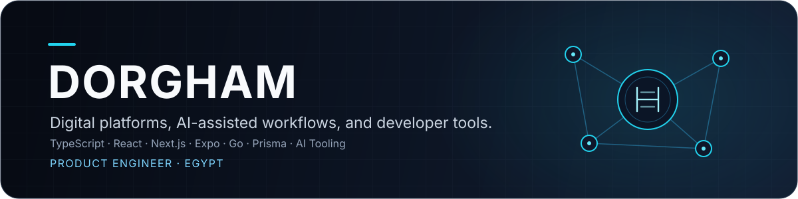

  

  
  
  

---

## About

I build products at the intersection of software engineering and applied AI. My work spans multi-tenant platforms, structured agent workflows, and developer tooling, with a focus on clear architecture, thoughtful user experience, and dependable systems.

## Selected Work

<table>
  <tr>
    <td width="64" align="center">
      
    </td>
    <td>
      <a href="https://github.com/iDorgham/Gateflow"><strong>GateFlow</strong></a> 
      Multi-tenant access management for gated communities, with QR-based access and Arabic/English workflows for residents, visitors, security teams, and operators.  
      
      
      
      
    </td>
  </tr>
  <tr>
    <td width="64" align="center">
      
    </td>
    <td>
      <a href="https://github.com/iDorgham/Nezam"><strong>Nezam</strong></a> 
      A structured AI workspace for planning, design governance, and gated agent workflows across the development lifecycle.  
      
      
      
    </td>
  </tr>
  <tr>
    <td width="64" align="center">
      
    </td>
    <td>
      <a href="https://github.com/iDorgham/DJ-Assistant"><strong>DJ Assistant</strong></a> 
      A desktop-first preparation tool that analyzes local music libraries, cleans metadata, generates intelligent cue points, and builds harmonic, energy-aware DJ sets.  
      
      
      
    </td>
  </tr>
  <tr>
    <td width="64" align="center">
      
    </td>
    <td>
      <a href="https://github.com/mediabubble-adv/mediaBubble"><strong>mediaBubble</strong></a> 
      A bilingual agency platform for Egypt and the UAE, combining public-facing websites, brand systems, and AI-assisted operations.  
      
      
      
    </td>
  </tr>
  <tr>
    <td width="64" align="center">
      
    </td>
    <td>
      <a href="https://github.com/mediabubble-adv/arabic-skill"><strong>Arabic Skill</strong></a> 
      An Arabic-first content agency skill designed to help AI agents produce relevant, high-quality content for the Arab world.  
      
      
      
    </td>
  </tr>
</table>

## Areas of Focus

- **Product engineering:** Multi-tenant applications, operational workflows, and bilingual digital experiences.
- **Applied AI:** Structured agent systems, AI-assisted development environments, and practical automation.
- **Developer experience:** CLI tools, reusable workflows, and tooling that reduces setup and repetitive work.

---

## Connect

I’m open to discussing collaborations involving thoughtful products, practical AI systems, and developer tools.

[Visit my website](https://dorgham.me) · [View my ORCID profile](https://orcid.org/0009-0000-7669-8984)
